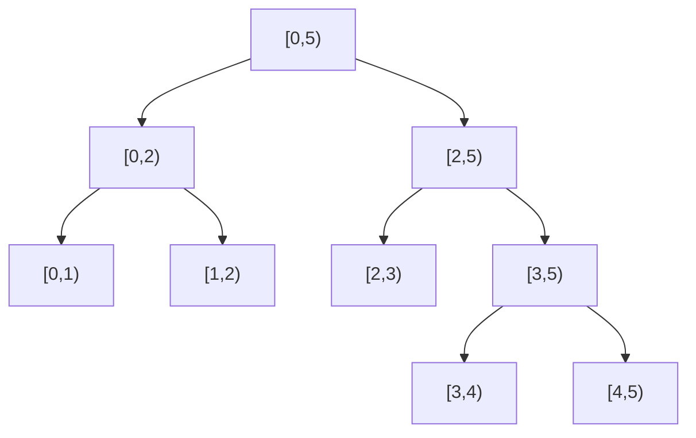

# Informe de corrección

Taller 4 — Simulación de partículas en paralelo.
Fundamentos de Programación Funcional y Concurrente, Universidad del Valle.

Este informe argumenta que cada función del taller hace lo que el enunciado
pide. Se siguen las dos técnicas del ejemplo del curso: **inducción
estructural** para los programas recursivos y **estado, invariante y
transformación** para los iterativos. Se demuestran de forma explícita las
tres cosas que exige la rúbrica:

1. La notación matemática respalda cada argumento (secciones 1 a 5).
2. Partir el sistema en segmentos **no pierde ni repite** partículas
   (Lema 1, sección 1.4).
3. La operación con que se combinan los resultados parciales es
   **asociativa**, y por eso la versión paralela da el mismo resultado que la
   secuencial (Teoremas 1, 3 y 4).

## 0. Notación y supuestos

- Un sistema es un arreglo $s$ de $n$ partículas, con índices
  $0, 1, \ldots, n-1$. La partícula $i$ tiene posición $p_i$, velocidad $v_i$ y
  masa $m_i \geq 0$.
- Un **tramo** es un intervalo semiabierto de índices $[d, h)$ con
  $0 \leq d \leq h \leq n$. Tiene $h - d$ elementos y contiene los índices
  $d, d+1, \ldots, h-1$.
- La energía cinética de una partícula es
  $e_i = \tfrac{1}{2}\, m_i\, \lVert v_i \rVert^2$.
- Sea $u = \max(\text{umbral}, 1)$. Todas las funciones repartidas usan $u$ en
  lugar de `umbral`. Con `umbral` $\leq 0$ un tramo de un elemento nunca
  dejaría de partirse (la mitad de 1 es 0 y el tramo no se reduce), así que
  $u$ garantiza que la recursión termina para **todo** umbral, como pide el
  enunciado.
- El punto medio de un tramo es $m = d + \lfloor (h-d)/2 \rfloor$. Así el
  tramo izquierdo $[d, m)$ tiene $\lfloor k/2 \rfloor$ elementos y el derecho
  $[m, h)$ tiene $\lceil k/2 \rceil$, donde $k = h - d$.
- `parallel(a, b)` evalúa `a` y `b` posiblemente a la vez y devuelve el par
  de resultados. Todas las funciones de este taller son **puras**: leen el
  arreglo `s` y nunca escriben en él. Cada llamado construye arreglos o
  valores nuevos que no comparte con el otro. Por eso `parallel(a, b)` devuelve
  el mismo par $(a, b)$ que devolvería evaluar `a` y luego `b`: no hay
  condiciones de carrera ni dependencia del orden de ejecución.
- Los argumentos matemáticos trabajan con números reales. Al final de cada
  punto se dice qué cambia con los `Double` de punto flotante (sección 3.5).

El código que se analiza es el de `SimulacionParticulas.scala`, sin `var`,
`while` ni `return`.

---

## 1. Punto 1: un paso de la simulación

### 1.1 Programas

```scala
def mover(p: Particula, dt: Double): Particula =
  Particula(p.pos + p.vel * dt, p.vel, p.masa)

def pasoSegmento(s: Sistema, dt: Double, desde: Int, hasta: Int): Sistema =
  Array.tabulate(hasta - desde)(j => mover(s(desde + j), dt))

def pasoSecuencial(s: Sistema, dt: Double): Sistema =
  pasoSegmento(s, dt, 0, s.length)

def pasoParalelo(s: Sistema, dt: Double, umbral: Int): Sistema = {
  val u = math.max(umbral, 1)
  def rec(d: Int, h: Int): Sistema =
    if (h - d <= u) pasoSegmento(s, dt, d, h)
    else {
      val m = d + (h - d) / 2
      val (izq, der) = parallel(rec(d, m), rec(m, h))
      izq ++ der
    }
  rec(0, s.length)
}
```

### 1.2 Especificación

Sea $f_{\text{paso}}(s, dt)$ el sistema $s'$ de $n$ partículas tal que, para
todo $0 \leq i < n$:

```math
s'_i = (\,p_i + v_i \cdot dt,\; v_i,\; m_i\,)
```

Es decir, la posición avanza $v_i \cdot dt$ y la velocidad y la masa no
cambian. Con `mover` definida como arriba, $s'_i = \text{mover}(s_i, dt)$.

Se debe demostrar que, para todo sistema $s$, todo $dt$ y todo umbral:

```math
\text{pasoParalelo}(s, dt, \text{umbral}) = \text{pasoSecuencial}(s, dt) = f_{\text{paso}}(s, dt)
```

### 1.3 Corrección de `pasoSegmento` y `pasoSecuencial`

`Array.tabulate(len)(g)` construye un arreglo nuevo de longitud `len` cuyo
elemento $j$ es $g(j)$. Por lo tanto, para $0 \leq d \leq h \leq n$:

- La longitud de $\text{pasoSegmento}(s, dt, d, h)$ es $h - d$.
- Para $0 \leq j < h - d$, el elemento $j$ es $\text{mover}(s_{d+j}, dt)$.

Es decir, el elemento $j$ del resultado es el de la partícula del índice
$d + j$ ya avanzada. Con $d = 0$ y $h = n$ se obtiene
$\text{pasoSecuencial}(s, dt)_i = \text{mover}(s_i, dt) = s'_i$ para todo
$0 \leq i < n$, así que $\text{pasoSecuencial} = f_{\text{paso}}$.

Con los ejemplos del enunciado: $(0,0) + (1,2)\cdot 2 = (2,4)$, y con
$dt = 0$ resulta $(0,0)$.

### 1.4 Lema 1 (la partición no pierde ni repite elementos)

> **Lema 1.** Para todo tramo $[d, h)$, $\text{rec}(d, h)$ devuelve un arreglo
> $r$ de longitud $h - d$ tal que
> $r_j = \text{mover}(s_{d+j}, dt)$ para $0 \leq j < h - d$.

**Demostración**, por inducción fuerte sobre $k = h - d$.

**Caso base:** $k \leq u$. Entonces `rec` devuelve
$\text{pasoSegmento}(s, dt, d, h)$, y por la sección 1.3 cumple lo pedido. Esto
incluye el tramo vacío ($k = 0$), que devuelve el arreglo vacío.

**Caso de inducción:** $k > u \geq 1$, de modo que $k \geq 2$. Sea
$m = d + \lfloor k/2 \rfloor$.

1. *Los dos tramos son más pequeños y no vacíos.* Como $k \geq 2$,
   $1 \leq \lfloor k/2 \rfloor < k$, y por lo tanto $d < m < h$. Además
   $\lceil k/2 \rceil < k$. Los dos tramos tienen menos de $k$ elementos, y se
   puede aplicar la hipótesis de inducción (HI).
2. *Por la HI*, $\text{izq} = \text{rec}(d, m)$ tiene longitud
   $a = \lfloor k/2 \rfloor$ y
   $\text{izq}_j = \text{mover}(s_{d+j}, dt)$ para $0 \leq j < a$.
   Igualmente $\text{der} = \text{rec}(m, h)$ tiene longitud
   $b = \lceil k/2 \rceil$ y $\text{der}_j = \text{mover}(s_{m+j}, dt)$
   para $0 \leq j < b$.
3. *La concatenación.* $\text{izq} \mathbin{+\!\!+} \text{der}$ tiene longitud
   $a + b = k$. Su elemento $j$ es $\text{izq}_j$ si $j < a$ y
   $\text{der}_{j-a}$ si $j \geq a$. En el segundo caso:

```math
\text{der}_{j-a} = \text{mover}(s_{m + j - a}, dt) = \text{mover}(s_{d + j}, dt)
```

porque $m - a = d$. Entonces, para **todo** $0 \leq j < k$, el elemento $j$
del resultado es $\text{mover}(s_{d+j}, dt)$. $\blacksquare$

**Por qué esto significa que no se pierde ni se repite nada.** Los dos tramos
$[d, m)$ y $[m, h)$ cumplen:

```math
[d, m) \cap [m, h) = \emptyset \qquad\text{y}\qquad [d, m) \cup [m, h) = [d, h)
```

Es decir, forman una **partición** de $[d, h)$: cada índice cae en exactamente
un tramo. Aplicada de forma recursiva, la partición de $[0, n)$ termina en
tramos pequeños que son disjuntos entre sí y cuya unión es $[0, n)$: cada
partícula se procesa **exactamente una vez**. La concatenación $\mathbin{+\!\!+}$
coloca el resultado de cada tramo en su lugar, en el orden de los índices, y
eso se demostró en el punto 3 de la inducción.

Como ejemplo, con $n = 5$ y umbral $1$ la recursión produce este árbol. Las
hojas son $[0,1), [1,2), [2,3), [3,4), [4,5)$: cinco tramos, cada índice
exactamente una vez.



**Terminación.** En cada llamado recursivo el tamaño del tramo disminuye
estrictamente (paso 1 del caso de inducción) y el caso base se alcanza cuando
el tamaño es a lo sumo $u$. Por lo tanto la recursión termina para todo
umbral.

### 1.5 Teorema 1 (la versión paralela da lo mismo que la secuencial)

> **Teorema 1.** Para todo sistema $s$, todo $dt$ y todo umbral:
> $\text{pasoParalelo}(s, dt, \text{umbral}) = \text{pasoSecuencial}(s, dt)$.

**Demostración.** `pasoParalelo` devuelve $\text{rec}(0, n)$. Por el Lema 1 con
$d = 0$ y $h = n$, ese arreglo tiene longitud $n$ y su elemento $j$ es
$\text{mover}(s_j, dt)$. Por la sección 1.3, el arreglo de `pasoSecuencial`
tiene la misma longitud y los mismos elementos. Dos arreglos con la misma
longitud y los mismos elementos en cada posición son iguales. Esto vale para
cualquier umbral, porque el Lema 1 no depende de él. $\blacksquare$

En este punto la igualdad es **exacta**, también con `Double`: cada elemento
se calcula con la misma expresión $p_i + v_i \cdot dt$ sin importar cómo se
agrupe el trabajo, y no hay sumas entre partículas que cambien de orden.

**Caso de control.** Si $\text{umbral} \geq n \geq 1$, entonces
$n \leq u$ y `rec(0, n)` cae en el caso base:
$\text{pasoParalelo}(s, dt, n) = \text{pasoSegmento}(s, dt, 0, n)$, que es
literalmente el cuerpo de `pasoSecuencial`. Las dos versiones ejecutan la misma
función, sin ningún `parallel`, y por eso la aceleración medida con ese
umbral debe dar $1$ (sección 5).

---

## 2. Punto 2: magnitudes globales en secuencial

Las tres funciones recorren el arreglo con una recursión de cola, es decir,
un programa **iterativo**. Se argumentan con estado, estado inicial, estado
final, invariante y transformación, como en el ejemplo del curso.

### 2.1 Especificación

```math
E(s) = \sum_{i=0}^{n-1} e_i = \sum_{i=0}^{n-1} \tfrac{1}{2}\, m_i \lVert v_i \rVert^2
\qquad
M(s) = \sum_{i=0}^{n-1} m_i
\qquad
S(s) = \sum_{i=0}^{n-1} m_i\, p_i
```

```math
CM(s) = \begin{cases} S(s) / M(s) & \text{si } M(s) \neq 0 \\ (0, 0) & \text{si } M(s) = 0 \end{cases}
```

Una suma sin términos vale $0$ (en el caso de $S$, el vector $(0,0)$). Por eso
$E(\text{Array}()) = 0$.

### 2.2 `energiaSecuencial`

```scala
def energiaSecuencial(s: Sistema): Double = {
  def iter(i: Int, ac: Double): Double =
    if (i >= s.length) ac
    else {
      val v = s(i).vel.norma
      iter(i + 1, ac + 0.5 * s(i).masa * v * v)
    }
  iter(0, 0.0)
}
```

- Estado: $(i, ac)$.
- Estado inicial: $s_0 = (0, 0)$.
- Estado final: $i \geq n$.
- Invariante: $\text{Inv}(i, ac) \equiv 0 \leq i \leq n \;\land\; ac = \sum_{k=0}^{i-1} e_k$.
- Transformación: $\text{transformar}(i, ac) = (i + 1,\; ac + e_i)$.

**1. $\text{Inv}(s_0)$.** $0 \leq 0 \leq n$ y $ac = 0$ es la suma vacía.

**2. La invariante se conserva.** Suponga $i < n$ y $\text{Inv}(i, ac)$. El
nuevo estado es $(i+1, ac + e_i)$. Se cumple $0 \leq i + 1 \leq n$, y

```math
ac + e_i = \sum_{k=0}^{i-1} e_k + e_i = \sum_{k=0}^{i} e_k = \sum_{k=0}^{(i+1)-1} e_k
```

**3. Del estado final al resultado.** El estado final tiene $i \geq n$, y con
la invariante $i = n$. Entonces $ac = \sum_{k=0}^{n-1} e_k = E(s)$.

**4. Terminación.** En cada paso $n - i$ baja en 1 y es no negativo; después
de $n$ pasos $i = n$.

Por lo tanto $\text{energiaSecuencial}(s) = E(s)$. Con el ejemplo del
enunciado: $e_0 = \tfrac12 \cdot 2 \cdot 5^2 = 25$ y $e_1 = 0$, así que $E = 25$.

### 2.3 `masaTotal`

```scala
def masaTotal(s: Sistema): Double = {
  def iter(i: Int, ac: Double): Double =
    if (i >= s.length) ac else iter(i + 1, ac + s(i).masa)
  iter(0, 0.0)
}
```

Es el mismo argumento de la sección 2.2 con $e_i$ reemplazado por $m_i$:
estado $(i, ac)$, inicial $(0, 0)$, final $i \geq n$,
$\mathrm{Inv}(i, ac) \equiv 0 \leq i \leq n \land ac = \sum_{k < i} m_k$,
transformación $(i, ac) \mapsto (i+1, ac + m_i)$. Al terminar,
$ac = \sum_{k < n} m_k = M(s)$, y la terminación es la misma, porque $n - i$
baja en 1 en cada paso.

### 2.4 `centroDeMasaSecuencial`

```scala
def centroDeMasaSecuencial(s: Sistema): Vector2 = {
  def iter(i: Int, sx: Vector2, ms: Double): (Vector2, Double) =
    if (i >= s.length) (sx, ms)
    else iter(i + 1, sx + s(i).pos * s(i).masa, ms + s(i).masa)
  val (sx, mt) = iter(0, Vector2(0, 0), 0.0)
  if (mt == 0.0) Vector2(0, 0) else sx * (1.0 / mt)
}
```

- Estado: $(i, sx, ms)$.
- Estado inicial: $(0, (0,0), 0)$, es decir $i = 0$, $sx = (0,0)$, $ms = 0$.
- Estado final: $i \geq n$.
- Invariante: $\mathrm{Inv}(i, sx, ms) \equiv 0 \leq i \leq n \land sx = \sum_{k < i} m_k p_k \land ms = \sum_{k < i} m_k$.
- Transformación: $(i, sx, ms) \mapsto (i+1,\; sx + m_i p_i,\; ms + m_i)$.
La demostración es la de la sección 2.2, aplicada a las dos componentes a la
vez: el estado inicial cumple la invariante porque las dos sumas son vacías;
si la invariante vale en $i$, al sumar el término $i$ vale en $i+1$; y la
terminación es la misma. En el estado final $sx = S(s)$ y $ms = M(s)$. Después
de la iteración se divide **una sola vez**: si $M(s) = 0$ el resultado es el
origen, y si no es $S(s) \cdot (1 / M(s)) = S(s) / M(s)$. Eso es $CM(s)$.

Con el ejemplo del enunciado: $S = 2 \cdot (0,0) + 2 \cdot (4,0) = (8, 0)$,
$M = 4$ y $CM = (2, 0)$.

---

## 3. Punto 3: las mismas magnitudes en paralelo

### 3.1 Programas

```scala
def energiaParalela(s: Sistema, umbral: Int): Double = {
  val u = math.max(umbral, 1)
  def tramo(d: Int, h: Int): Double = {            // iterativo sobre [d, h)
    def iter(i: Int, ac: Double): Double =
      if (i >= h) ac
      else { val v = s(i).vel.norma; iter(i + 1, ac + 0.5 * s(i).masa * v * v) }
    iter(d, 0.0)
  }
  def rec(d: Int, h: Int): Double =
    if (h - d <= u) tramo(d, h)
    else {
      val m = d + (h - d) / 2
      val (a, b) = parallel(rec(d, m), rec(m, h))
      a + b
    }
  rec(0, s.length)
}

def centroDeMasaParalelo(s: Sistema, umbral: Int): Vector2 = {
  val u = math.max(umbral, 1)
  def tramo(d: Int, h: Int): (Vector2, Double) = { // (suma ponderada, masa)
    def iter(i: Int, sx: Vector2, ms: Double): (Vector2, Double) =
      if (i >= h) (sx, ms)
      else iter(i + 1, sx + s(i).pos * s(i).masa, ms + s(i).masa)
    iter(d, Vector2(0, 0), 0.0)
  }
  def rec(d: Int, h: Int): (Vector2, Double) =
    if (h - d <= u) tramo(d, h)
    else {
      val m = d + (h - d) / 2
      val ((sa, ma), (sb, mb)) = parallel(rec(d, m), rec(m, h))
      (sa + sb, ma + mb)
    }
  val (sx, mt) = rec(0, s.length)
  if (mt == 0.0) Vector2(0, 0) else sx * (1.0 / mt)
}
```

### 3.2 La operación de combinación es asociativa

Cada hoja de la recursión calcula una **magnitud parcial** de su tramo, y cada
nodo interno combina las de sus dos hijos.

- Para la energía, las magnitudes parciales son números reales y la
  combinación es la suma $+$.
- Para el centro de masa, las magnitudes parciales son pares
  $(S, M) \in \mathbb{R}^2 \times \mathbb{R}$ (suma ponderada de posiciones y
  masa) y la combinación es la suma componente a componente:

```math
(S_1, M_1) \oplus (S_2, M_2) = (S_1 + S_2,\; M_1 + M_2)
```

**Proposición 2.** $\oplus$ es **asociativa**, **conmutativa** y tiene
elemento neutro $(\vec{0}, 0)$. Lo mismo vale para la suma de reales.

**Demostración.** Se calcula componente a componente, y cada componente es
una suma de reales (o de vectores de $\mathbb{R}^2$), que es asociativa y
conmutativa y tiene a $0$ como neutro:

```math
\big((S_1, M_1) \oplus (S_2, M_2)\big) \oplus (S_3, M_3) = (S_1 + S_2 + S_3,\; M_1 + M_2 + M_3) = (S_1, M_1) \oplus \big((S_2, M_2) \oplus (S_3, M_3)\big)
```

El neutro es $(\vec{0}, 0)$ porque $(S, M) \oplus (\vec{0}, 0) = (S, M)$. $\blacksquare$

**Por qué importa la asociatividad.** El recorrido secuencial suma de
izquierda a derecha: $(\cdots((e_d + e_{d+1}) + e_{d+2}) + \cdots)$. La
recursión paralela combina en forma de **árbol**, con otros paréntesis, por
ejemplo $(e_d + e_{d+1}) + (e_{d+2} + e_{d+3})$. Que ambas formas den el mismo
valor es exactamente la asociatividad (con la conmutatividad no hace falta: la
recursión conserva el orden de los índices). El neutro $0$ cubre el tramo
vacío ($n = 0$).

### 3.3 Teorema 3 (energía)

> **Teorema 3.** Para todo sistema $s$ y todo umbral:
> $\text{energiaParalela}(s, \text{umbral}) = E(s)$ (en $\mathbb{R}$).

**Lema 3.** Para todo tramo $[d, h)$, $\text{rec}(d, h) = \sum_{k=d}^{h-1} e_k$.

**Demostración**, por inducción fuerte sobre $k = h - d$.

**Caso base:** $k \leq u$. Entonces `rec` devuelve $\text{tramo}(d, h)$. Ese
`tramo` es iterativo con estado $(i, ac)$, inicial $(d, 0)$, final $i \geq h$ y
$\text{Inv}(i, ac) \equiv d \leq i \leq h \land ac = \sum_{k=d}^{i-1} e_k$. La
demostración es la de la sección 2.2 cambiando los límites: el estado inicial
cumple la invariante (suma vacía), cada transformación la conserva, el estado
final tiene $i = h$ y $ac = \sum_{k=d}^{h-1} e_k$, y la terminación está
garantizada porque $h - i$ baja en 1 en cada paso.

**Caso de inducción:** $k > u \geq 1$. Como en el Lema 1, $d < m < h$ y los
dos tramos son más pequeños, así que vale la HI:
$a = \sum_{k=d}^{m-1} e_k$ y $b = \sum_{k=m}^{h-1} e_k$. Entonces

```math
a + b = \sum_{k=d}^{m-1} e_k + \sum_{k=m}^{h-1} e_k = \sum_{k=d}^{h-1} e_k
```

La última igualdad es la que garantiza que no se pierde ni se repite
ninguna partícula: $[d, m)$ y $[m, h)$ son una partición de $[d, h)$ (Lema 1),
así que cada $e_k$ aparece exactamente una vez. $\blacksquare$

**Demostración del Teorema 3.** Por el Lema 3 con $d = 0$ y $h = n$,
$\text{energiaParalela}(s, \text{umbral}) = \sum_{k=0}^{n-1} e_k = E(s)$, que
es lo que calcula `energiaSecuencial` (sección 2.2). $\blacksquare$

### 3.4 Teorema 4 (centro de masa) y por qué los promedios no se promedian

> **Teorema 4.** Para todo sistema $s$ y todo umbral:
> $\text{centroDeMasaParalelo}(s, \text{umbral}) = CM(s)$ (en $\mathbb{R}$).

**Lema 4.** Para todo tramo $[d, h)$:

```math
\text{rec}(d, h) = \Big( \sum_{k=d}^{h-1} m_k p_k,\; \sum_{k=d}^{h-1} m_k \Big)
```

**Demostración.** Es la del Lema 3 para las dos componentes a la vez. En el caso
base, `tramo` es el iterativo de la sección 2.4 con límites $[d, h)$. En el
caso de inducción, la HI da los pares de $[d, m)$ y $[m, h)$, y $\oplus$ los
suma componente a componente. Como $[d, m)$ y $[m, h)$ son una partición de
$[d, h)$, la suma de las dos mitades es la suma de todo el tramo. $\blacksquare$

**Demostración del Teorema 4.** Por el Lema 4, `rec(0, n)` devuelve
$(S(s), M(s))$. Después se divide una sola vez, igual que en
`centroDeMasaSecuencial`: origen si $M(s) = 0$ y $S(s)/M(s)$ si no.
$\blacksquare$

**Por qué la suma es válida para repartir y el promedio no.**

- La **suma** es asociativa (Proposición 2) y tiene neutro. Eso permite
  agrupar el trabajo como se quiera y obtener lo mismo, y un tramo sin
  partículas simplemente aporta $(\vec{0}, 0)$.
- El **promedio no es una operación que se pueda aplicar a los resultados
  parciales directamente**, por dos razones.
  1. *Ignora cuánto pesa cada mitad.* Sea la mitad $A$ con una partícula de
     masa $1$ en $x = 0$, y la mitad $B$ con una partícula de masa $3$ en
     $x = 4$. Los centros de masa parciales son $0$ y $4$, y su promedio es
     $2$. Pero el centro de masa verdadero es
     $\dfrac{1 \cdot 0 + 3 \cdot 4}{1 + 3} = 3$.
  2. *No es asociativa.* Con $\text{prom}(a, b) = (a + b)/2$:

```math
\text{prom}(\text{prom}(0, 4), 8) = \tfrac{2 + 8}{2} = 5
\qquad\neq\qquad
\text{prom}(0, \text{prom}(4, 8)) = \tfrac{0 + 6}{2} = 3
```

     El resultado dependería de cómo se agruparan los tramos, es decir, de
     cómo se repartió el trabajo.
- Por eso se lleva el par $(S, M)$, cuya combinación sí es asociativa, y la
  división $S/M$ se hace **una sola vez, al final**.

### 3.5 Punto flotante

Los Teoremas 3 y 4 son exactos en $\mathbb{R}$. Con `Double` (IEEE 754) la suma
**no es exactamente asociativa**: cambiar los paréntesis cambia el redondeo.
Entonces la versión paralela y la secuencial no siempre coinciden bit a bit,
sino con una diferencia muy pequeña. Para la energía, que suma términos no
negativos, el error de cualquier orden de suma es a lo sumo
$\gamma_{n-1} E$, con $\gamma_{n-1} \approx (n-1)\, u_{\text{máq}}$ y
$u_{\text{máq}} = 2^{-53}$; la diferencia entre las dos versiones queda por
debajo del doble de eso. Por esta razón las pruebas comparan con una
**tolerancia** y no con igualdad exacta, como pide el enunciado. Esto es
distinto del punto 1, donde la igualdad sí es exacta porque no hay sumas entre
partículas.

---

## 4. Punto 4: trabajo y profundidad

### 4.1 Programas

```scala
def trabajo(n: Int): Int = n

def profundidad(n: Int, umbral: Int): Int = {
  val u = math.max(umbral, 1)
  if (n <= u) n else 1 + profundidad((n + 1) / 2, umbral)
}

def tiempoEstimado(n: Int, p: Int, umbral: Int): Double =
  profundidad(n, umbral) + trabajo(n).toDouble / p
```

`(n + 1) / 2` es $\lceil n/2 \rceil$ en enteros, el tamaño del tramo **mayor**
cuando se parte por la mitad (sección 0).

### 4.2 Especificación

- **Trabajo:** una operación por partícula, y repartir no lo reduce:
  $W(n) = n$.
- **Profundidad:** el número de veces que se parte a la mitad hasta llegar al
  umbral, más el trabajo del tramo que queda sin partir. Es decir:

```math
D(n) = \begin{cases} n & \text{si } n \leq u \\ 1 + D(\lceil n/2 \rceil) & \text{si } n > u \end{cases}
```

- **Tiempo estimado:** $T(n, p) = D(n) + W(n)/p$.

### 4.3 Terminación y forma cerrada de `profundidad`

**Terminación.** En el caso recursivo $n > u \geq 1$, o sea $n \geq 2$, y
$\lceil n/2 \rceil < n$. Cada llamado recibe un entero estrictamente menor y
siempre $\geq 1$, así que se llega al caso base.

> **Proposición 5.** Sea $k(n) = \min\{\, k \geq 0 : \lceil n/2^k \rceil \leq u \,\}$.
> Entonces $D(n) = k(n) + \lceil n / 2^{k(n)} \rceil$.

**Demostración**, por inducción fuerte sobre $n$.

**Caso base:** $n \leq u$. Entonces $k(n) = 0$ y
$D(n) = n = 0 + \lceil n/1 \rceil$.

**Caso de inducción:** $n > u$. Entonces $k(n) \geq 1$. Para enteros vale
$\lceil \lceil n/2 \rceil / 2^j \rceil = \lceil n / 2^{j+1} \rceil$, así que
$k(\lceil n/2 \rceil) = k(n) - 1$. Por la HI aplicada a $\lceil n/2 \rceil < n$:

```math
D(n) = 1 + D(\lceil n/2 \rceil) = 1 + \big(k(n) - 1\big) + \Big\lceil \tfrac{\lceil n/2 \rceil}{2^{k(n)-1}} \Big\rceil = k(n) + \lceil n/2^{k(n)} \rceil \qquad \blacksquare
```

### 4.4 Los ejemplos del enunciado

| Llamado | $k$ | Cálculo | Resultado |
|---|---|---|---|
| `profundidad(1024, 1024)` | 0 | $0 + 1024$ | 1024 |
| `profundidad(1024, 512)` | 1 | $1 + \lceil 1024/2 \rceil = 1 + 512$ | 513 |
| `profundidad(1024, 1)` | 10 | $10 + \lceil 1024/1024 \rceil = 10 + 1$ | 11 |
| `tiempoEstimado(1024, 4, 1)` | 10 | $11 + 1024/4$ | 267.0 |
| `trabajo(1024)` | | $n$ | 1024 |

### 4.5 Alcance de la estimación

`profundidad` es la definición del enunciado: cuenta las particiones sobre el
tramo **mayor** ($\lceil n/2 \rceil$). Es una **estimación del camino crítico**
de `pasoParalelo` y coincide con él cuando los tramos de un mismo nivel tienen
el mismo tamaño, por ejemplo cuando $n$ es una potencia de 2. En otros casos es
una aproximación, porque `parallel` termina cuando acaba la rama más lenta. Es
una cota que se compara con lo medido, no una medida exacta (se discute en el
informe de paralelización).

---

## 5. Punto 5: medir la aceleración

### 5.1 Programas

```scala
def aceleracion(tSecuencial: Double, tParalelo: Double): Double =
  tSecuencial / tParalelo

def umbralConveniente(s: Sistema, dt: Double, umbrales: List[Int]): Int =
  if (umbrales.isEmpty) s.length
  else umbrales.map(u => (u, medir(pasoParalelo(s, dt, u)))).minBy(_._2)._1
```

`medir` es la función que trae el repositorio: devuelve la mediana de varias
corridas en milisegundos, después de descartar una de calentamiento.

### 5.2 `aceleracion`

La especificación es el cociente $A = t_{\text{sec}} / t_{\text{par}}$, con
$t_{\text{par}} > 0$ (un tiempo medido nunca es cero), y el programa es
literalmente ese cociente. Los ejemplos: $100/25 = 4$ y $100/100 = 1$.

**Caso de control.** Por la sección 1.5, con umbral igual al tamaño del sistema
`pasoParalelo` ejecuta el mismo código que `pasoSecuencial`. Los tiempos son
dos mediciones de la misma computación, así que
$A = t/t' \approx 1$, con la única diferencia del ruido de la medición. Si el
control da un valor muy distinto de $1$, la comparación no es justa (por
ejemplo, si las dos versiones recorren el arreglo con operaciones distintas).

### 5.3 `umbralConveniente`

**Especificación.** Sea $L$ la lista de umbrales y $t(u)$ el tiempo medido de
$\text{pasoParalelo}(s, dt, u)$. Si $L = \emptyset$, el resultado es $n$, que
equivale a no repartir (el mismo caso de control). Si no, el resultado es un
$u^* \in L$ tal que $t(u^*) \leq t(u)$ para todo $u \in L$.

**Argumento.**

1. *Lista vacía:* el programa devuelve `s.length` $= n$.
2. *Lista no vacía:* `umbrales.map(...)` produce una lista de pares
   $(u, t(u))$ con un elemento por cada $u \in L$, en el mismo orden. `minBy`
   devuelve un elemento cuyo segundo componente es mínimo (el primero, si hay
   empates), y `._1` toma su umbral. Entonces $u^* \in L$ y
   $t(u^*) \leq t(u)$ para todo $u \in L$.

**Límite de esta garantía.** A diferencia de las otras funciones, el resultado
depende de **mediciones** y no solo de los datos de entrada. La función es
correcta respecto a los tiempos medidos en esa ejecución; con otra máquina o
con otra carga, otro umbral podría ganar si los tiempos son muy parecidos. Por
eso `medir` usa la mediana de varias corridas: reduce el efecto de una
corrida atípica.

---

## 6. Resumen

| Función | Técnica | Qué se demuestra |
|---|---|---|
| `mover`, `pasoSegmento`, `pasoSecuencial` | Definición de `tabulate` | Cada elemento es la partícula $i$ avanzada $dt$ |
| `pasoParalelo` | Inducción fuerte (Lema 1) | La partición no pierde ni repite; es igual a `pasoSecuencial` (Teorema 1) |
| `energiaSecuencial`, `masaTotal`, `centroDeMasaSecuencial` | Invariante de ciclo | El estado final contiene la suma pedida |
| `energiaParalela` | Inducción fuerte (Lema 3) y asociatividad de $+$ | Igual a $E(s)$ (Teorema 3) |
| `centroDeMasaParalelo` | Inducción fuerte (Lema 4) y asociatividad de $\oplus$ | Igual a $CM(s)$ (Teorema 4); el promedio no sirve como combinación |
| `trabajo`, `profundidad`, `tiempoEstimado` | Inducción fuerte (Proposición 5) | Forma cerrada y ejemplos del enunciado |
| `aceleracion`, `umbralConveniente` | Definición y propiedad de `minBy` | Cociente de tiempos; el umbral devuelto es el de menor tiempo medido |

Correspondencia con la rúbrica:

- **Paralelismo, criterio 2** (la división en segmentos no pierde ni repite):
  Lema 1, sección 1.4, y Lema 3, sección 3.3.
- **Paralelismo, criterio 3** (la operación que combina es asociativa):
  Proposición 2, sección 3.2.
- **Corrección, criterio 3** (la versión paralela da lo mismo que la
  secuencial): Teoremas 1, 3 y 4, secciones 1.5, 3.3 y 3.4, con la salvedad de
  punto flotante de la sección 3.5.