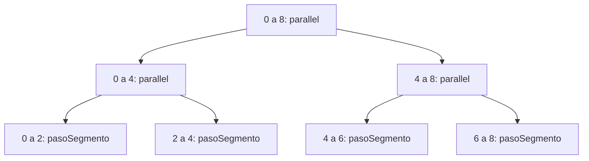

# Informe de paralelización

Taller 4 — Simulación de partículas en paralelo.
Fundamentos de Programación Funcional y Concurrente, Universidad del Valle.

## 1. La estrategia de reparto

### 1.1 Dónde se reparte

Se reparte en dos lugares:

- **El paso de la simulación (Punto 1).** `pasoSegmento` actualiza un tramo del sistema con `mover`, y el movimiento de una partícula no depende de las demás. Por eso los tramos se pueden resolver de forma independiente.
- **Las magnitudes globales (Punto 3).** `energiaParalela` y `centroDeMasaParalelo` reparten el recorrido del arreglo con la misma estrategia, y combinan resultados parciales.

La abstracción es `parallel`, del paquete `common`: recibe dos cálculos, los evalúa posiblemente a la vez y devuelve el par de resultados.

### 1.2 Con qué criterio se deja de partir

El tramo `[desde, hasta)` se parte por la mitad, en `mitad = desde + (hasta - desde) / 2`, mientras tenga más elementos que el umbral. Cuando tiene a lo sumo `umbral` elementos, o a lo sumo uno, se resuelve en secuencial. La condición de un solo elemento evita que un umbral cero o negativo parta indefinidamente.

```scala
def pasoParalelo(s: Sistema, dt: Double, umbral: Int): Sistema = {
  def avanzar(desde: Int, hasta: Int): Sistema =
    if (hasta - desde <= umbral || hasta - desde <= 1)
      pasoSegmento(s, dt, desde, hasta)
    else {
      val mitad = desde + (hasta - desde) / 2
      val (izquierda, derecha) = parallel(
        avanzar(desde, mitad),
        avanzar(mitad, hasta))
      izquierda ++ derecha
    }

  avanzar(0, s.length)
}
```

El árbol de llamados para un sistema de ocho partículas con umbral 2 queda así, con las hojas resolviendo en secuencial:



Ningún índice aparece en dos tramos ni queda por fuera: el primero va de `desde` a `mitad` y el segundo de `mitad` a `hasta`, sin incluir el límite superior de cada uno.

### 1.3 Qué operación combina los resultados parciales

| Función | Resultado parcial de cada tramo | Operación que combina |
|---|---|---|
| `pasoParalelo` | Un arreglo con las partículas movidas | Concatenación `izquierda ++ derecha` |
| `energiaParalela` | Un número: la energía del tramo | Suma `+` |
| `centroDeMasaParalelo` | Un par: suma ponderada de posiciones y masa | Suma componente a componente |

Las tres son **asociativas**, y por eso agrupar el trabajo en un árbol da lo mismo que recorrerlo de izquierda a derecha (se demuestra en el informe de corrección). En el centro de masa se lleva el par y se divide **una sola vez**, al final. No se promedian los promedios de cada mitad, porque las mitades pueden pesar distinto.

La concatenación con `++` copia los dos arreglos en uno nuevo en **cada nivel** del árbol. Es trabajo que la versión secuencial no hace, y pesa en los resultados (sección 4).

---

## 2. Cómo se tomaron los tiempos

Cada cifra se obtiene con ScalaMeter, la librería que usa el curso. La expresión `withWarmer(new Warmer.Default) measure { ... }` calienta la máquina virtual antes de medir, para reducir el efecto de las optimizaciones iniciales. La función `medir` repite la medición y devuelve la mediana. Los tiempos de las tablas son la mediana de cinco mediciones. Dentro de `umbralConveniente`, para elegir el umbral, se usan tres mediciones por candidato.

```scala
def medir[A](repeticiones: Int)(cuerpo: => A): Double = {
  val muestras = Vector.fill(repeticiones) {
    (withWarmer(new Warmer.Default) measure { cuerpo }).value
  }
  muestras.sorted.apply(muestras.length / 2)
}

def aceleracion(tSecuencial: Double, tParalelo: Double): Double =
  tSecuencial / tParalelo
```

La aceleración es el cociente entre el tiempo secuencial y el paralelo:

```math
S = \frac{T_{secuencial}}{T_{paralelo}}
```

Las dos versiones actualizan las partículas con la misma función `mover` y construyen su resultado con `Array.tabulate` (la paralela, además, concatena). La diferencia de tiempos corresponde, entonces, al reparto y a la combinación de los resultados parciales.

**La fila de control** usa un umbral igual al tamaño del sistema. Ahí `pasoParalelo` no parte nada y ejecuta directamente `pasoSegmento` sobre todo el arreglo, que es lo que hace `pasoSecuencial`. Por eso la aceleración debe dar 1. Si no da 1, la comparación no es justa o la medición está contaminada.

**La máquina** en que se midió tiene **12 procesadores lógicos**. Los sistemas tienen 1.000.000 y 1.500.000 partículas, con `dt = 0,5`. Las partículas se generan con `Array.tabulate`, con posiciones y velocidades que dependen del índice y masas entre 1 y 3. Los tiempos están en milisegundos.

---

## 3. Las mediciones

### 3.1 Sistema de 1.000.000 de partículas

| **Umbral** | **Niveles de división** | **Secuencial (ms)** | **Paralela (ms)** | **Aceleración** |
| ---------- | ----------------------- | ------------------- | ----------------- | --------------- |
| 1 000 000 (control) | 0 | 25,9797 | 27,0795 | 0,959 |
| 125 000 | 3 | 25,9797 | 16,4118 | 1,583 |
| 15 625 | 6 | 25,9797 | 14,8497 | **1,750** |
| 976 | 11 | 25,9797 | 15,6280 | 1,662 |

El control da 0,959, cerca de 1, como se espera: las dos versiones ejecutan el mismo código y la diferencia es ruido de medición. El mejor resultado es con umbral 15.625, con aceleración 1,75 y una reducción del tiempo de aproximadamente el 42,84 %.

### 3.2 Sistema de 1.500.000 de partículas: medición no válida

| **Umbral** | **Niveles de división** | **Secuencial (ms)** | **Paralela (ms)** | **Aceleración** |
| ---------- | ----------------------- | ------------------- | ----------------- | --------------- |
| 1 500 000 (control) | 0 | 35,5215 | 86,8666 | 0,409 |
| 187 500 | 3 | 35,5215 | 121,7970 | 0,292 |
| 23 437 | 7 | 35,5215 | 99,7153 | 0,356 |
| 1 464 | 11 | 35,5215 | 110,5460 | 0,321 |

**Esta serie no se usa para sacar conclusiones.** Su fila de control da 0,409, y debería dar 1: en ese umbral las dos versiones ejecutan el mismo código. Un control tan alejado de 1 indica que la medición paralela está contaminada por algo ajeno al reparto. Dos señales apuntan en esa dirección:

- El tiempo secuencial (35,5 ms) es coherente con el del sistema de 1.000.000 (26,0 ms), porque el sistema es 1,5 veces mayor.
- Los tiempos paralelos (87 a 122 ms) son entre 4 y 8 veces los de 1.000.000 (15 a 27 ms), un salto que el tamaño no explica.

Una explicación posible es la presión de memoria y la recolección de basura de la máquina virtual con arreglos de ese tamaño, pero no se verificó. Por lo tanto, de esta serie solo se concluye que **la medición no es confiable**, y no que paralelizar un sistema mayor sea peor.

---

## 4. Comparación con la estimación del Punto 4

La estimación del Punto 4 no ejecuta nada: `tiempoEstimado(n, p, umbral)` suma la profundidad y el trabajo entre `p` procesadores. Como el trabajo secuencial es $n$ operaciones (una por partícula), la aceleración estimada es $n / \text{tiempoEstimado}(n, p, \text{umbral})$. Con $n = 1\,000\,000$ y $p = 12$:

| Umbral | `profundidad` | `tiempoEstimado` | Aceleración estimada | Aceleración medida |
|---|---|---|---|---|
| 125 000 | 3 + 125 000 = 125 003 | 125 003 + 83 333,3 ≈ 208 336 | ≈ 4,80 | 1,583 |
| 15 625 | 6 + 15 625 = 15 631 | 15 631 + 83 333,3 ≈ 98 964 | ≈ 10,10 | **1,750** |
| 976 | 986 | 986 + 83 333,3 ≈ 84 319 | ≈ 11,86 | 1,662 |

Las unidades de `tiempoEstimado` son operaciones, no milisegundos, y por eso se comparan las aceleraciones. Para el control (umbral igual a $n$) la estimación no aplica: no hay partición, y la fórmula suma el tramo completo dos veces.

**En qué se parecen.**

- Los dos dicen que repartir ayuda: pasar de umbral 125.000 a 15.625 mejora la aceleración, tanto en lo estimado como en lo medido.
- Los dos muestran que la ganancia no crece de forma proporcional al número de particiones.

**En qué no se parecen.**

- **La magnitud.** La estimación llega a unas 10 veces con 12 procesadores, y lo medido es 1,75. Se mide menos de una quinta parte de lo estimado.
- **El mejor umbral.** La estimación mejora siempre que el umbral baja, porque solo mira la profundidad, y sugeriría 976. En lo medido, 976 es peor que 15.625.

**A qué lo atribuyo.** La estimación cuenta una operación por partícula y ninguna otra cosa. No incluye:

- **La concatenación.** Cada nivel del árbol copia los arreglos con `++`. La concatenación de la raíz copia las 1.000.000 de referencias en un solo hilo, y las de los niveles inferiores suman otro tanto. Esto es trabajo que la versión secuencial no hace y que no se reparte.
- **La creación de tareas.** Con umbral 976 hay unas 2.048 tareas, frente a unas 64 con 15.625. Cada una tiene un costo fijo, y por eso el umbral más pequeño deja de ganar.
- **La memoria.** `mover` crea objetos nuevos por cada partícula (la partícula copiada y dos vectores intermedios). El cálculo es corto por elemento y depende más del acceso a memoria y de la recolección de basura que de la aritmética, y la memoria se comparte entre los núcleos.

Estas son explicaciones probables que no se midieron por separado.

---

## 5. La lectura de los resultados

### 5.1 Qué umbral resultó conveniente y por qué

En el sistema de 1.000.000 de partículas, el umbral más conveniente fue **15.625**, con aceleración 1,75. Corresponde a seis niveles de división y 64 tramos para 12 procesadores lógicos: hay bastantes tramos para repartir entre los núcleos (más del cuádruple de los procesadores, lo que compensa tramos que terminan antes que otros), y cada tramo tiene trabajo suficiente para pagar el costo de crear la tarea.

- Con un umbral grande (125.000) hay solo 8 tramos. Quedan núcleos sin trabajo y la aceleración es 1,58.
- Con un umbral pequeño (976) hay unas 2.048 tareas, y el costo de crearlas y de concatenar tantos resultados parciales quita parte de la ganancia: 1,66.
- Con el umbral igual al tamaño, no hay reparto y la aceleración es 0,96, es decir, 1 con ruido.

El umbral conveniente no es el más pequeño ni el más grande, sino un punto intermedio.

### 5.2 Por qué la aceleración deja de crecer aunque se agreguen núcleos

Aunque se agreguen núcleos, hay una parte del cálculo que no se reparte. Eso está en el algoritmo y no en la máquina:

- La concatenación de la raíz es secuencial. Hasta que no terminan las dos mitades, no se puede unir el arreglo final.
- La reserva de memoria y la recolección de basura se comparten, y todos los hilos acceden a la misma memoria.

Esa parte fija pone un techo a la aceleración, y los núcleos adicionales solo aceleran la parte que sí se reparte (ley de Amdahl).

### 5.3 Qué fracción del cálculo no se reparte

Con la ley de Amdahl, donde $S(p)$ es la aceleración con $p$ procesadores y $f$ la fracción que no se reparte:

```math
S(p)=\frac{1}{f+\frac{1-f}{p}}
```

Despejando $f$:

```math
f=\frac{\frac{1}{S}-\frac{1}{p}}{1-\frac{1}{p}}
```

Con la mejor aceleración medida, $S = 1{,}7495$ (umbral 15.625), y $p = 12$:

```math
f=\frac{\frac{1}{1.7495}-\frac{1}{12}}{1-\frac{1}{12}}\approx 0{,}533
```

Es decir, aproximadamente el **53,3 %** del cálculo no se reparte, y el 46,7 % restante sí. Es una fracción **efectiva**: agrupa todo lo que impide la aceleración ideal (concatenación, memoria, recolección de basura, costo de las tareas), no solo la parte estrictamente secuencial. Se calcula con un solo punto de medición, en una sola máquina.

La aceleración máxima teórica con esa fracción constante es:

```math
S_{\max}=\frac{1}{f}\approx 1{,}88
```

| p | 2 | 4 | 8 | 12 | 16 | 32 | ∞ |
|---|---:|---:|---:|---:|---:|---:|---:|
| Aceleración máxima estimada | 1,30 | 1,54 | 1,69 | 1,75 | 1,78 | 1,83 | 1,88 |

Pasar de 12 a 32 procesadores subiría la aceleración estimada de 1,75 a 1,83, una mejora pequeña. Esto es coherente con lo medido: con 12 procesadores lógicos ya se está cerca del techo.

### 5.4 Conclusión

- Repartir mejora el tiempo de `pasoParalelo` cuando el umbral es adecuado: 1,75 veces con 1.000.000 de partículas y umbral 15.625.
- La ganancia queda lejos de la estimada porque la estimación ignora la concatenación, las tareas y la memoria.
- La fila de control es la que dice si una comparación es confiable. Con 1.000.000 de partículas da 0,959 y la serie es válida. Con 1.500.000 da 0,409, y esa serie no se usa para concluir.
