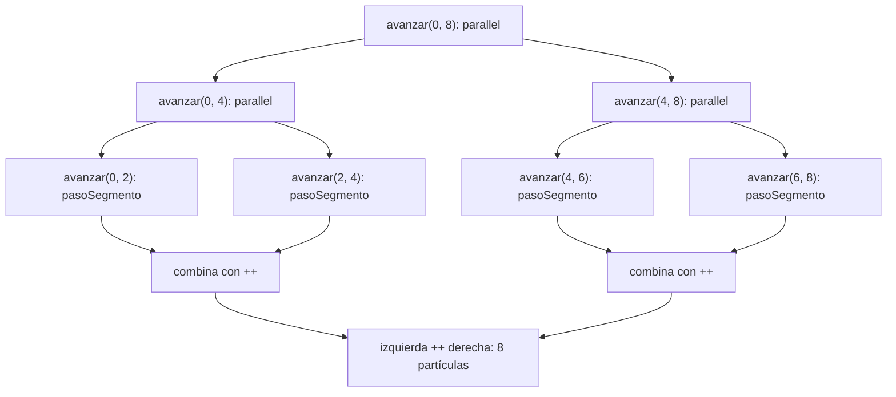
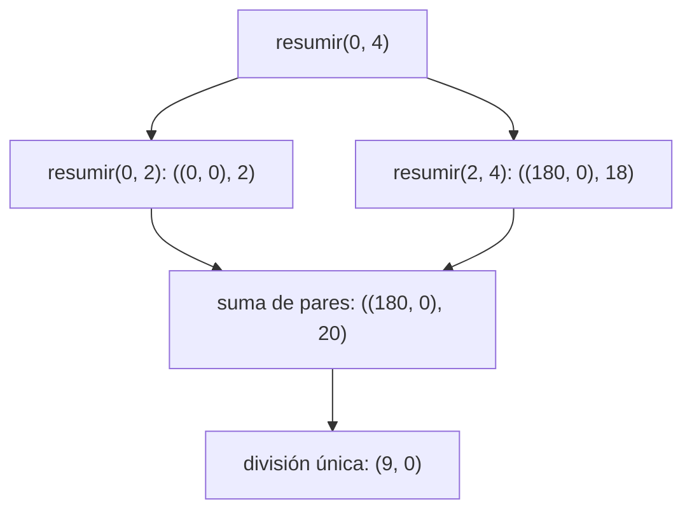

# Informe de proceso

Taller 4 — Simulación de partículas en paralelo.
Fundamentos de Programación Funcional y Concurrente, Universidad del Valle.

Este informe explica, paso a paso, cómo se ejecuta cada función del taller. Cada una se acompaña de un ejemplo pequeño con su traza. En las funciones repartidas se indica qué tramo resuelve cada llamado y cómo se combinan los resultados parciales.

Convenciones:

- Un **tramo** `[desde, hasta)` incluye `desde` y excluye `hasta`.
- `Vector2(x, y)` se escribe `(x, y)` en las trazas.
- Una partícula se escribe `P(pos, vel, masa)`.
- `umbral` es el tamaño de tramo a partir del cual se deja de partir y se resuelve en secuencial.

---

## 1. Punto 1: un paso de la simulación

### 1.1 `mover`

```scala
def mover(p: Particula, dt: Double): Particula =
  p.copy(pos = p.pos + p.vel * dt)
```

Calcula la partícula nueva: la posición es la anterior más la velocidad por `dt`. La velocidad y la masa se copian sin cambios.

Ejemplo: `p = P((0, 0), (1, 2), 1.0)` y `dt = 2.0`.

| Paso | Operación | Resultado |
|---|---|---|
| 1 | `p.vel * dt` | `(1, 2) * 2.0 = (2, 4)` |
| 2 | `p.pos + (2, 4)` | `(0, 0) + (2, 4) = (2, 4)` |
| 3 | `p.copy(pos = (2, 4))` | `P((2, 4), (1, 2), 1.0)` |

### 1.2 `pasoSegmento`

```scala
def pasoSegmento(s: Sistema, dt: Double, desde: Int, hasta: Int): Sistema =
  Array.tabulate(hasta - desde)(i => mover(s(desde + i), dt))
```

Construye un arreglo nuevo de `hasta - desde` elementos. El elemento `i` del resultado es la partícula del índice `desde + i`, ya movida.

Ejemplo: un sistema de cinco partículas, donde la partícula `i` es `P((i, 0), (0, i), 1.0)`, con `dt = 2.0`, `desde = 1` y `hasta = 4`.

| `i` | Partícula leída `s(desde + i)` | `mover(..., 2.0)` |
|---|---|---|
| 0 | `s(1) = P((1, 0), (0, 1), 1.0)` | pos `(1, 0) + (0, 2) = (1, 2)` |
| 1 | `s(2) = P((2, 0), (0, 2), 1.0)` | pos `(2, 0) + (0, 4) = (2, 4)` |
| 2 | `s(3) = P((3, 0), (0, 3), 1.0)` | pos `(3, 0) + (0, 6) = (3, 6)` |

El resultado tiene tres partículas, con posiciones `(1, 2)`, `(2, 4)` y `(3, 6)`. Las partículas de los índices 0 y 4 no se tocan, porque quedan fuera del tramo.

### 1.3 `pasoSecuencial`

```scala
def pasoSecuencial(s: Sistema, dt: Double): Sistema =
  pasoSegmento(s, dt, 0, s.length)
```

Es `pasoSegmento` sobre todo el sistema, como un solo tramo `[0, s.length)`. No hay recursión ni reparto.

Ejemplo con el sistema `s` del enunciado y `dt = 1.0`:

- `s = [P((0, 0), (3, 4), 2.0), P((4, 0), (0, 0), 2.0)]`.
- La llamada es `pasoSegmento(s, 1.0, 0, 2)`.
- La partícula 0 pasa a `(0, 0) + (3, 4) = (3, 4)`.
- La partícula 1 se queda en `(4, 0) + (0, 0) = (4, 0)`.

### 1.4 `pasoParalelo`

```scala
def pasoParalelo(s: Sistema, dt: Double, umbral: Int): Sistema = {
  def avanzar(desde: Int, hasta: Int): Sistema =
    if (hasta - desde <= umbral || hasta - desde <= 1)
      pasoSegmento(s, dt, desde, hasta)
    else {
      val mitad = desde + (hasta - desde) / 2
      val (izquierda, derecha) = parallel(
        avanzar(desde, mitad),
        avanzar(mitad, hasta))
      izquierda ++ derecha
    }

  avanzar(0, s.length)
}
```

La función interna `avanzar(desde, hasta)` resuelve un tramo:

1. **Caso base.** Si el tramo tiene a lo sumo `umbral` partículas, o a lo sumo una, se resuelve con `pasoSegmento`. La condición de una sola partícula evita que un umbral cero o negativo parta indefinidamente.
2. **Caso recursivo.** Se calcula `mitad`, se parte el tramo en `[desde, mitad)` y `[mitad, hasta)`, y se resuelven las dos partes con `parallel`.
3. **Combinación.** `izquierda ++ derecha` concatena los dos arreglos, el izquierdo primero. Así se conserva el orden original de las partículas.

**Ejemplo.** Un sistema de 8 partículas, donde la partícula `i` es `P((i, 0), (1, 0), 1.0)`, con `dt = 0.1` y `umbral = 2`. Cada partícula debe quedar en `(i + 0.1, 0)`.

Traza de los llamados:

| Llamado | Tamaño | ¿Se parte? | Qué hace |
|---|---|---|---|
| `avanzar(0, 8)` | 8 | Sí, 8 > 2 | `mitad = 4`; lanza `avanzar(0, 4)` y `avanzar(4, 8)` en paralelo |
| `avanzar(0, 4)` | 4 | Sí, 4 > 2 | `mitad = 2`; lanza `avanzar(0, 2)` y `avanzar(2, 4)` |
| `avanzar(4, 8)` | 4 | Sí, 4 > 2 | `mitad = 6`; lanza `avanzar(4, 6)` y `avanzar(6, 8)` |
| `avanzar(0, 2)` | 2 | No, 2 ≤ 2 | `pasoSegmento(s, 0.1, 0, 2)`: posiciones `(0.1, 0)`, `(1.1, 0)` |
| `avanzar(2, 4)` | 2 | No | `pasoSegmento(s, 0.1, 2, 4)`: posiciones `(2.1, 0)`, `(3.1, 0)` |
| `avanzar(4, 6)` | 2 | No | `pasoSegmento(s, 0.1, 4, 6)`: posiciones `(4.1, 0)`, `(5.1, 0)` |
| `avanzar(6, 8)` | 2 | No | `pasoSegmento(s, 0.1, 6, 8)`: posiciones `(6.1, 0)`, `(7.1, 0)` |

Combinación de abajo hacia arriba:

- `avanzar(0, 4)` devuelve `[(0.1), (1.1)] ++ [(2.1), (3.1)] = [(0.1), (1.1), (2.1), (3.1)]`.
- `avanzar(4, 8)` devuelve `[(4.1), (5.1)] ++ [(6.1), (7.1)] = [(4.1), (5.1), (6.1), (7.1)]`.
- `avanzar(0, 8)` devuelve la concatenación de las dos: las 8 partículas, en el orden original.



**Un sistema impar.** Con 5 partículas y `umbral = 1`, `avanzar(0, 5)` calcula `mitad = 0 + 5 / 2 = 2` y parte en `[0, 2)` y `[2, 5)`. El tramo `[2, 5)` calcula `mitad = 2 + 3 / 2 = 3` y parte en `[2, 3)` y `[3, 5)`. Las hojas son `[0, 1)`, `[1, 2)`, `[2, 3)`, `[3, 4)` y `[4, 5)`: cada partícula aparece en un solo tramo.

**El caso de control.** Si `umbral` es mayor o igual que el tamaño del sistema, `avanzar(0, n)` cae directo en el caso base y ejecuta `pasoSegmento(s, dt, 0, n)`. Es exactamente lo que hace `pasoSecuencial`, sin llamar a `parallel`.

---

## 2. Punto 2: magnitudes globales en secuencial

Las tres funciones recorren el arreglo de izquierda a derecha con `foldLeft`, que lleva un acumulador y lo actualiza con cada partícula.

### 2.1 `energiaSecuencial`

```scala
def energiaSecuencial(s: Sistema): Double =
  s.foldLeft(0.0) { (total, p) =>
    total + 0.5 * p.masa * p.vel.norma * p.vel.norma
  }
```

El acumulador `total` empieza en `0.0`. Por cada partícula suma su energía cinética, media masa por la norma de la velocidad al cuadrado.

Ejemplo con `s = [P((0, 0), (3, 4), 2.0), P((4, 0), (0, 0), 2.0)]`:

| Partícula | Norma de la velocidad | Energía `0.5 * m * v * v` | `total` después |
|---|---|---|---|
| (inicio) | | | 0.0 |
| `P((0, 0), (3, 4), 2.0)` | 5 | `0.5 * 2 * 5 * 5 = 25` | 25.0 |
| `P((4, 0), (0, 0), 2.0)` | 0 | `0.5 * 2 * 0 * 0 = 0` | 25.0 |

El resultado es `25.0`. Con el sistema vacío, `foldLeft` no recorre nada y devuelve el valor inicial `0.0`.

### 2.2 `masaTotal`

```scala
def masaTotal(s: Sistema): Double =
  s.foldLeft(0.0)((total, p) => total + p.masa)
```

Con el mismo sistema: el acumulador pasa de `0.0` a `2.0` con la primera partícula y a `4.0` con la segunda. El resultado es `4.0`.

### 2.3 `centroDeMasaSecuencial`

```scala
def centroDeMasaSecuencial(s: Sistema): Vector2 = {
  val (posicionPonderada, masa) = s.foldLeft((Vector2(0.0, 0.0), 0.0)) {
    case ((suma, masaAcumulada), p) =>
      (suma + p.pos * p.masa, masaAcumulada + p.masa)
  }
  if (masa == 0.0) Vector2(0.0, 0.0)
  else posicionPonderada * (1.0 / masa)
}
```

El acumulador es un par: la suma de las posiciones ponderadas por la masa y la masa acumulada. Se divide **una sola vez**, al final.

Ejemplo con el mismo sistema:

| Partícula | Posición ponderada `pos * masa` | Acumulador `(suma, masa)` después |
|---|---|---|
| (inicio) | | `((0, 0), 0.0)` |
| `P((0, 0), (3, 4), 2.0)` | `(0, 0) * 2 = (0, 0)` | `((0, 0), 2.0)` |
| `P((4, 0), (0, 0), 2.0)` | `(4, 0) * 2 = (8, 0)` | `((8, 0), 4.0)` |

Como la masa total es `4.0` y no es cero, el resultado es `(8, 0) * (1 / 4) = (2, 0)`. Con masa total cero, por ejemplo en el sistema vacío, se devuelve el origen `(0, 0)` y no se divide.

---

## 3. Punto 3: las mismas magnitudes en paralelo

### 3.1 `energiaParalela`

```scala
def energiaParalela(s: Sistema, umbral: Int): Double = {
  def sumar(desde: Int, hasta: Int): Double =
    if (hasta - desde <= umbral || hasta - desde <= 1) {
      def acumular(i: Int, total: Double): Double =
        if (i >= hasta) total
        else {
          val v = s(i).vel.norma
          acumular(i + 1, total + 0.5 * s(i).masa * v * v)
        }
      acumular(desde, 0.0)
    }
    else {
      val mitad = desde + (hasta - desde) / 2
      val (izquierda, derecha) = parallel(
        sumar(desde, mitad),
        sumar(mitad, hasta))
      izquierda + derecha
    }

  sumar(0, s.length)
}
```

`sumar(desde, hasta)` devuelve la energía del tramo:

- **Hoja.** Si el tramo es pequeño, `acumular` lo recorre por índice, desde `desde` hasta `hasta - 1`. En cada llamada suma la energía de la partícula `i` y se llama con `i + 1`. La suma que va llevando viaja como parámetro, no como variable.
- **Nodo interno.** Parte el tramo por la mitad, resuelve las dos partes con `parallel` y **suma** los dos resultados.

Ejemplo, con umbral 2 y estas cuatro partículas (solo importan velocidad y masa):

| Índice | Velocidad | Masa | Energía |
|---|---|---|---|
| 0 | `(3, 4)` | 2 | `0.5 * 2 * 25 = 25` |
| 1 | `(0, 0)` | 2 | 0 |
| 2 | `(6, 8)` | 1 | `0.5 * 1 * 100 = 50` |
| 3 | `(0, 2)` | 4 | `0.5 * 4 * 4 = 8` |

| Llamado | Tramo | Qué hace | Resultado |
|---|---|---|---|
| `sumar(0, 4)` | `[0, 4)` | 4 > 2: parte en `[0, 2)` y `[2, 4)` en paralelo | `25 + 58 = 83` |
| `sumar(0, 2)` | `[0, 2)` | Hoja: `acumular(0, 0.0)` suma 25 y luego 0 | 25 |
| `sumar(2, 4)` | `[2, 4)` | Hoja: `acumular(2, 0.0)` suma 50 y luego 8 | 58 |

El resultado es `83.0`, igual que lo que daría `energiaSecuencial` sobre las cuatro partículas.

### 3.2 `centroDeMasaParalelo`

```scala
def centroDeMasaParalelo(s: Sistema, umbral: Int): Vector2 = {
  def resumir(desde: Int, hasta: Int): (Vector2, Double) =
    if (hasta - desde <= umbral || hasta - desde <= 1)
      s.slice(desde, hasta).foldLeft((Vector2(0.0, 0.0), 0.0)) {
        case ((suma, masaAcumulada), p) =>
          (suma + p.pos * p.masa, masaAcumulada + p.masa)
      }
    else {
      val mitad = desde + (hasta - desde) / 2
      val (izquierda, derecha) = parallel(
        resumir(desde, mitad),
        resumir(mitad, hasta))
      (izquierda._1 + derecha._1, izquierda._2 + derecha._2)
    }

  val (posicionPonderada, masa) = resumir(0, s.length)
  if (masa == 0.0) Vector2(0.0, 0.0)
  else posicionPonderada * (1.0 / masa)
}
```

Cada tramo devuelve un **par**: la suma ponderada de sus posiciones y su masa. Los pares de las dos mitades se suman componente a componente, y la división entre la masa total se hace una sola vez, al final. No se promedian los promedios de cada mitad, porque las mitades pueden pesar distinto.

Ejemplo, con umbral 2 y cuatro partículas quietas: dos de masa 1 en `x = 0` y dos de masa 9 en `x = 10`.

| Llamado | Tramo | Qué hace | Par `(suma ponderada, masa)` |
|---|---|---|---|
| `resumir(0, 4)` | `[0, 4)` | 4 > 2: parte en dos y suma los pares | `((180, 0), 20)` |
| `resumir(0, 2)` | `[0, 2)` | Hoja: `(0, 0) * 1 + (0, 0) * 1`, masa `1 + 1` | `((0, 0), 2)` |
| `resumir(2, 4)` | `[2, 4)` | Hoja: `(10, 0) * 9 + (10, 0) * 9`, masa `9 + 9` | `((180, 0), 18)` |

Al final se divide una sola vez: `(180, 0) * (1 / 20)`, que es `(9, 0)`. Si se hubieran promediado los promedios de cada mitad, que son `0` y `10`, habría salido `5`, que es incorrecto.



---

## 4. Punto 4: trabajo y profundidad

Estas funciones estiman el costo sin ejecutar ningún cálculo sobre partículas.

### 4.1 `trabajo`

```scala
def trabajo(n: Int): Int = n
```

Una operación por partícula. Repartir el sistema no cambia ese número: `trabajo(1024)` es `1024`, y partir el sistema en dos mitades deja `trabajo(512) + trabajo(512) = 1024`.

### 4.2 `profundidad`

```scala
def profundidad(n: Int, umbral: Int): Int =
  if (n <= 0) 0
  else if (n <= umbral || n <= 1) n
  else {
    val mitad = n / 2
    1 + math.max(profundidad(mitad, umbral), profundidad(n - mitad, umbral))
  }
```

Cuenta cuántas veces se parte hasta llegar al umbral y suma el tamaño del tramo que queda sin partir. Como `parallel` termina cuando acaba la rama más lenta, se toma el máximo de las dos mitades.

Ejemplo: `profundidad(8, 2)`.

| Llamado | Caso | Resultado |
|---|---|---|
| `profundidad(8, 2)` | 8 > 2: `1 + max(profundidad(4, 2), profundidad(4, 2))` | `1 + 3 = 4` |
| `profundidad(4, 2)` | 4 > 2: `1 + max(profundidad(2, 2), profundidad(2, 2))` | `1 + 2 = 3` |
| `profundidad(2, 2)` | 2 ≤ 2: no se parte | 2 |

Con tramos de tamaños distintos, `profundidad(10, 3)` es 5: `10` se parte en `5` y `5`, y `profundidad(5, 3)` es `1 + max(profundidad(2, 3), profundidad(3, 3)) = 1 + max(2, 3) = 4`, así que el total es `1 + 4 = 5`. Los ejemplos del enunciado: `profundidad(1024, 1024) = 1024`, `profundidad(1024, 512) = 1 + 512 = 513` y `profundidad(1024, 1) = 10 + 1 = 11`.

### 4.3 `tiempoEstimado`

```scala
def tiempoEstimado(n: Int, p: Int, umbral: Int): Double =
  profundidad(n, umbral) + trabajo(n).toDouble / p
```

Suma la profundidad y el trabajo repartido entre `p` procesadores. Con `n = 8`, `p = 2` y `umbral = 2`: `profundidad(8, 2) = 4` y `trabajo(8) / 2 = 4.0`, así que el resultado es `8.0`. Con los datos del enunciado, `tiempoEstimado(1024, 4, 1) = 11 + 1024 / 4 = 267.0`.

---

## 5. Punto 5: medir la aceleración

### 5.1 `aceleracion`

```scala
def aceleracion(tSecuencial: Double, tParalelo: Double): Double =
  tSecuencial / tParalelo
```

Es el cociente de los dos tiempos: `aceleracion(100.0, 25.0) = 4.0`, y `aceleracion(100.0, 100.0) = 1.0`.

### 5.2 `umbralConveniente`

```scala
def umbralConveniente(s: Sistema, dt: Double, umbrales: List[Int]): Int =
  umbrales match {
    case Nil => s.length
    case primero :: resto =>
      val tiempoPrimero = medir(3) { pasoParalelo(s, dt, primero) }
      resto.foldLeft((primero, tiempoPrimero)) {
        case ((mejorUmbral, mejorTiempo), candidato) =>
          val tiempo = medir(3) { pasoParalelo(s, dt, candidato) }
          if (tiempo < mejorTiempo) (candidato, tiempo)
          else (mejorUmbral, mejorTiempo)
      }._1
  }
```

Mide `pasoParalelo` con cada candidato y se queda con el que menos tarda:

1. Si la lista está vacía, devuelve `s.length`, que equivale a no repartir.
2. Si no, mide el primer candidato y lo toma como el mejor hasta el momento.
3. Recorre el resto con `foldLeft`. El acumulador es el par `(mejor umbral, su tiempo)`. Un candidato solo lo reemplaza si su tiempo es **estrictamente menor**.
4. Al final, `._1` toma el umbral del par.

Ejemplo con `umbrales = List(1000, 100, 10000)`. Los tiempos son **supuestos**, solo para ilustrar la traza; los reales los entrega `medir`.

| Candidato | Tiempo medido (supuesto) | ¿`tiempo < mejorTiempo`? | Acumulador después |
|---|---|---|---|
| 1000 (primero) | 12.0 | | `(1000, 12.0)` |
| 100 | 9.5 | Sí, 9.5 < 12.0 | `(100, 9.5)` |
| 10000 | 14.0 | No, 14.0 ≥ 9.5 | `(100, 9.5)` |

El resultado es `100`. Con la lista `Nil`, el resultado es `s.length`.

### 5.3 `medir`

`medir(repeticiones)(cuerpo)` ejecuta el bloque `repeticiones` veces con `withWarmer(new Warmer.Default) measure`, de ScalaMeter. Cada medición se hace después de un calentamiento de la máquina virtual. Devuelve la mediana de esas mediciones, en milisegundos. `App.scala` la usa para medir `pasoSecuencial` y `pasoParalelo` sobre sistemas grandes y calcular la aceleración de cada umbral.
